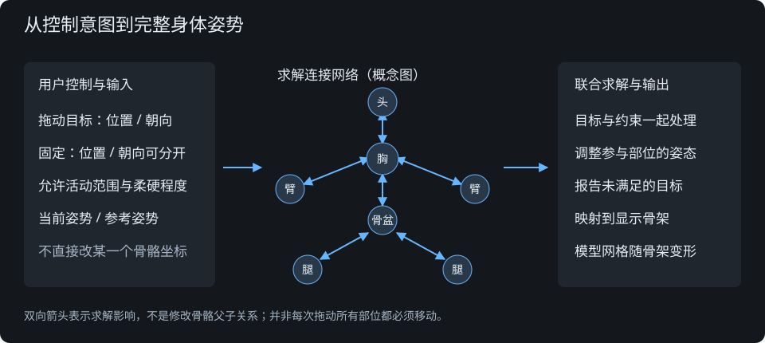

# 全身姿势控制体系：专题源码学习

2026-10-12。模式：架构地图、调用链追踪、模块精读。目标是理解外部完整体系，不围绕本项目已有手脚工具补规则；没有选定集成库或进入实现。

## 阅读基线与证据等级

- Cascadeur：官方Rig Elements、Point Controllers、Fixing Tools、Relaxation说明。闭源，只能确认官方公开行为，不能声称读过内部求解源码。
- BEPUik：上游`bepu/bepuphysics1`，提交`88243f8a688b792d4f5b617c67fce7847b2f78f0`。阅读`BEPUik/`核心和原交互示例，不是本项目修改版。v1旧C#实现；作者明确称实验项目，不能写成现成生产编辑器。
- closed-chain-ik-js：上游`gkjohnson/closed-chain-ik-js`，提交`1132da3dc3ac774426e9af503e4915bc04ca413b`。精读`src/core/Solver.js`、`ChainSolver.js`、`Joint.js`和`Goal.js`，提交固定源与先前读取内容一致。通用运动学求解器，不是自带人体约束的姿势产品。
- Unreal：官方Full Body IK/PBIK文档，只做公开接口交叉核对；没有将另外一个Jacobian FullBodyIK插件的说明混作PBIK内部源码。
- Maya：HumanIK官方操纵/设置关键帧模式与固定说明，只确认产品控制规则，不推断其闭源算法。
- 这是静态源码/文档学习，没有运行外部程序、安装依赖或完成同场景试摆；上轮浏览器控制失败不等于外部产品不可用。

## 1. 不是把模型骨骼加几个拖柄

要分清三类对象：模型骨骼负责网格变形；控制器表达用户希望的位置/朝向；求解模型表达关节连接、允许运动、固定、目标与姿势偏好。一个控制器不必对应一根完整骨骼，关节处可有多个控制点。

Cascadeur的[点控制器](https://cascadeur.com/help/rig/rig_structure/rig_elements/point_controllers)包括关节位置、主方向、附加方向点；[刚体](https://cascadeur.com/help/rig/rig_structure/rig_elements/rigid_bodies)有位置、朝向、质量与惯量；[模型关节](https://cascadeur.com/help/rig/rig_structure/rig_elements/joints)据Rig结果驱动网格。求解层与导入骨骼树不能直接画等号。

图是公开资料和两个开源实现的共同概念图，不是声称各产品内部采用同一算法。双向连接表达求解影响，不改变模型实际父子层级。

## 2. 全身联动是一套联合问题

目标可以放在头、胸、骨盆、中间关节或末端。求解器依连接与约束确定参与范围，遇到共享躯干、固定点、自由度限制时共同处理，而不是分别定义“手拉肩”“脚拉骨盆”函数。不是每次拖动每根骨骼都必须发生位移，也不是把全部骨骼同量平移。

[Cascadeur约束调整](https://cascadeur.com/help//relaxation_in_cascadeur)对关键帧的相连对象双向调整，尽量减少原位置/朝向变化；插值区间采用更简化的父到子处理。普通控制体系、AutoPosing预测及AutoPhysics是不同能力，不能把三者合并解释。

## 3. BEPUik：刚体＋连接约束网络

### 小地图与输入输出

`DragControl/StateControl`表示目标 → `IKSolver.Solve(controls)`建立活动集合 → 连接约束和控制目标共同迭代 → `Bone.Position/Orientation`更新。

这不是只有骨骼父链的单向递归。`Bone.joints`记录相邻连接；球接约束将两个刚体各自的局部连接点对齐；另用摆动、扭转或铰链约束限制活动。目标约束与连接约束不同：前者希望接近鼠标，后者保持身体结构。

### 关键源码证据

以下行号按实际下载的UTF-8源码计数，不使用网页抽取器删空行后的行号。

| 源码与符号 | 已确认行为 |
| --- | --- |
| `BEPUphysicsDemos/Demos/Extras/Tests/InverseKinematicsTestDemo.cs:883-946` | 射线挑选任意未固定骨体，设置DragControl.TargetBone，保留抓取点偏移；同一交互调用Solve，不区分手脚专用算法 |
| `BEPUik/DragControl.cs:11-32` | 目标可以是任意Bone；内部线性驱动负责位置目标 |
| `BEPUik/StateControl.cs:11-46` | 同一骨体可同时获得位置和朝向驱动，不等同只设一个位置 |
| `BEPUik/ActiveSet.cs:460-511` | 从全部控制骨体出发沿相邻关节广度遍历；固定骨体不作为后续遍历入口，但其连接约束仍参加 |
| `BEPUik/ActiveSet.cs:71-175` | 识别控制点到固定点及其他控制点的路径，为自动质量分配服务，不是按人体名字限定传播 |
| `BEPUik/IKBallSocketJoint.cs:41-71` | 计算两个连接点的世界位置差，给双方设置相反方向的约束作用 |
| `BEPUik/IKSwingLimit.cs:65-100` | 按两个骨体轴向夹角决定是否触及限制，限制独立于拖动目标 |
| `BEPUik/IKSolver.cs:146-280` | 一起迭代目标和关节；之后撤去目标影响做结构修正，避免不可达目标持续破坏结构；可能因此偏离鼠标目标 |

[求解器源码](https://github.com/bepu/bepuphysics1/blob/88243f8a688b792d4f5b617c67fce7847b2f78f0/BEPUik/IKSolver.cs)、[活动集合源码](https://github.com/bepu/bepuphysics1/blob/88243f8a688b792d4f5b617c67fce7847b2f78f0/BEPUik/ActiveSet.cs)、[交互示例](https://github.com/bepu/bepuphysics1/blob/88243f8a688b792d4f5b617c67fce7847b2f78f0/BEPUphysicsDemos/Demos/Extras/Tests/InverseKinematicsTestDemo.cs)。

质量与惯量决定调整分摊，固定是不同机制；软目标强度不等于严格固定。`Bone.UpdatePosition`更新姿态后清空中间速度，不是把普通重力物理模拟一直运行起来。连接约束在有限迭代下仍可能有残差，因此不能由“刚体体系”推出骨长误差永远为零或自动避免穿插。

## 4. closed-chain-ik-js：连接图＋多目标联合求解

### 小地图

`Link`是刚性段，`Joint`提供可动自由度；`Goal`是世界目标帧，通过闭合连接关联刚性段。输入包括关节值、允许轴、最小最大值、位置/朝向目标和参考姿势，不含内置人体语义。

`Solver.updateStructure()`找连接链，并把共享关节的链合并 → `ChainSolver.solve()`计算目标误差、可用自由度和雅可比矩阵 → 阻尼最小二乘得到联合调整 → 限幅/减小步长/重新求解。

### 关键源码证据

| 源码与符号 | 已确认行为 |
| --- | --- |
| `Solver.js:131-247` | 从闭合连接提取依赖，合并共享关节的链；完全独立的系统分别求解，不先分成四条人体末端链 |
| `ChainSolver.js:267-311` | 一起统计目标误差和自由变量，构造一个联立问题 |
| `ChainSolver.js:426-490` | 求关节增量；参考姿势通过剩余自由方向影响结果，用于消解多解；带阻尼和有限迭代时不承诺严格零误差 |
| `ChainSolver.js:523-598` | 试步、检查误差，拒绝并回退不合适步长，返回收敛/停滞/发散/超时状态 |
| `ChainSolver.js:602-697` | 应用关节限值，将触边的自由度从当前轮可动集合排除，重新分摊到其余变量 |
| `Joint.js:376-385,559-618` | 自由度值和角度限值分开，赋值时限制数值；无人体专属默认范围 |
| `Goal.js:3-65` | 位置和朝向可分开约束；旋转目标目前要求三个轴全约束或全不约束 |

[链求解源码](https://github.com/gkjohnson/closed-chain-ik-js/blob/1132da3dc3ac774426e9af503e4915bc04ca413b/src/core/ChainSolver.js)、[结构求解器](https://github.com/gkjohnson/closed-chain-ik-js/blob/1132da3dc3ac774426e9af503e4915bc04ca413b/src/core/Solver.js)、[目标定义](https://github.com/gkjohnson/closed-chain-ik-js/blob/1132da3dc3ac774426e9af503e4915bc04ca413b/src/core/Goal.js)。

更大的目标权重不自动等于严格优先级；多个矛盾目标仍可能无法满足。参考姿势由调用方设置，不能假设它自动就是用户刚才的姿势，更不能每次强拉回T形。骨骼只旋转、只有根平移还是允许伸缩，也是所建自由度模型决定的。

## 5. 成熟产品怎样控制可用性

[Unreal全身IK](https://dev.epicgames.com/documentation/en-us/unreal-engine/control-rig-full-body-ik-in-unreal-engine)分别配置：目标位置/朝向权重、影响强度、骨骼刚度、轴范围、偏好弯曲角、根处理和是否允许伸缩。根可自由、固定到输入姿势或先整体拉近；迭代是否从输入姿势开始也独立。不能把一个“最大弯曲角”当作整套配置。

[Maya HumanIK官方说明](https://help.autodesk.com/cloudhelp/2024/CHS/Maya-CharacterAnimation/files/GUID-6EB8580A-0344-42F1-A722-4FDFD5BFA70C.htm)区分全身、身体部位、仅选择模式；位置与旋转固定分别可开关。该模式也影响关键帧写入范围，不只是求解数学参数。默认脚部有位置和旋转固定，因此成熟工具不是统一“默认全部自由”。

用户可见的拖动方式、影响范围和固定反馈，与底层联合求解必须一致；否则数学能收敛也可能很难操作。这个结论是基于接口差异的学习推断，未完成操作次数对比。

## 6. 用非手脚例子检验理解

这是机制推演，不是已经运行出的姿势或已验证体验。

- 第1轮：胸部是位置目标，其余允许参与，求解模型同时包含颈部、躯干和骨盆连接；修改范围由模型约束和参考姿势确定，不存在必须先点手脚的前提。
- 第2轮：加入双脚位置目标，保持上一轮的脚落点。胸部目标仍在，脚、腿、骨盆和脊柱之间变成同一耦合问题；双腿可弯、骨盆可调整，脚朝向是否保持取决于是否另设朝向目标。
- 第3轮：再固定骨盆且把胸部目标移远。可用自由度减少；超过可达范围时，有限迭代可能留下目标残差、触发停滞或按刚体体系修正结构。不能保证同时满足每个目标，更不能用拉长骨骼掩盖失败。
- 第4轮：释放骨盆的位置固定，但保留其朝向约束。位置和朝向分开后，骨盆可以移动而不能随意转；联合问题与第3轮不同，不是一个“锁定”布尔量能够解释所有产品行为。

## 7. 本阶段小结与尚未确认

已读到的核心不是“手脚链变长”，而是全身控制模型、连接图和多目标共同求解。联动可从任何允许控制的部位出发；骨长、固定位置、固定朝向、活动限制、柔硬程度、保持原姿势是不同条件。

尚未确认：哪一个库适合本项目浏览器性能、不同模型轴向如何校准、实际冲突残差大小、连续拖动稳定性、是否足够接近实体人偶体验。没有将源码阅读等同集成验收，没有给出替换现有实现的结论。

后续学习如要继续，优先核对控制模型与导入骨架的映射、求解器约束配置和实际交互表现；本轮不生成实现任务、不改程序、不安装或运行第三方工程。
